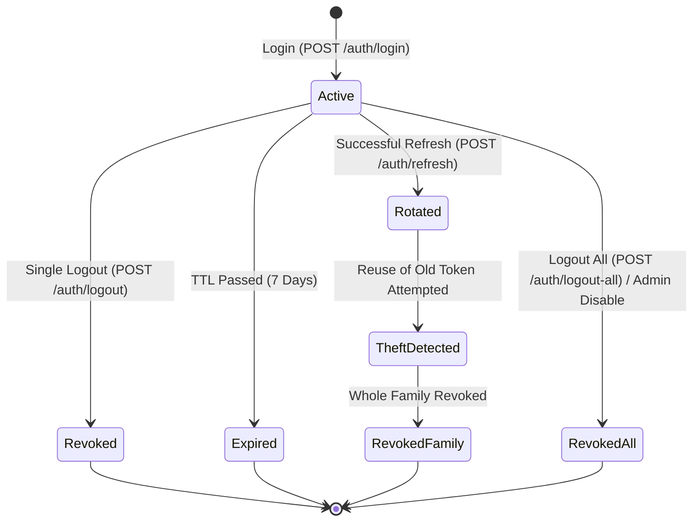

# LedgerCore Security Architecture & Threat Model

This document outlines the security architecture, threat model, and protective controls implemented in LedgerCore Phase 4, Step B (Refresh Tokens, Revocation & Security Hardening).

---

## 1. Authentication & Authorization Architecture

### 1.1 Stateless JWT Authentication & Instant Revocation
- **Mechanism**: OAuth2 Resource Server with JSON Web Tokens (JWT) using HMAC-SHA256 (`HS256`).
- **Signing Key**: Sourced from the `JWT_SECRET` environment variable. The application enforces a strict **fail-fast startup check requiring at least 32 bytes (256 bits)** of entropy. Startup failure messages **never print the secret value**.
- **Claims**:
  - `iss`: Hardcoded to `ledgercore` with strict validation.
  - `sub`: User ID (`UUID`).
  - `iat`: Issue timestamp (UTC).
  - `exp`: Expiration timestamp (default: 15 minutes / 900 seconds, configurable via `ledgercore.security.jwt.expiration-minutes`).
  - `jti`: Unique token identifier (`UUID`) preventing replay confusion.
  - `role`: Role of the user (`CUSTOMER` or `ADMIN`).
  - `token_version`: Monotonically increasing session generation counter.
- **Instant Revocation via `UserSecurityStateJwtAuthenticationConverter`**:
  - Stateless JWTs cannot typically be revoked before expiration without a database lookup. LedgerCore implements a fast, index-assisted database check on every authenticated request: `(enabled, role, token_version)`.
  - If the user has been disabled by an admin, or if `token_version` in the database exceeds the token claim (via `POST /auth/logout-all` or admin disable), the request is instantly rejected with `401 Unauthorized`.
  - The user's database role directly overrides the token claim, guaranteeing immediate effect if roles change.
- **Transport**: Authorization must be transmitted exclusively via the HTTP standard `Authorization: Bearer <token>` header. Tokens in cookies or query parameters are explicitly ignored and rejected.
- **Cache-Control**: All authentication endpoints (`/auth/register`, `/auth/login`, `/auth/refresh`) emit `Cache-Control: no-store` to prevent intermediary caching of tokens.

---

### 1.2 Refresh Tokens, Rotation & Family Theft Detection

- **Token Format**: Opaque 32 cryptographically random bytes generated via `SecureRandom` and encoded as URL-safe base64 string.
- **Zero-Storage of Raw Tokens**: Only the 64-character lowercase hexadecimal SHA-256 hash is stored in the `refresh_tokens` database table. The raw token is returned to the client once upon login or refresh.
- **TTL**: 7 days (configurable via `ledgercore.security.refresh-token-ttl`).
- **Rotation & Family Concept**:
  - Each login creates a new `family_id` (UUID).
  - Calling `POST /api/v1/auth/refresh` atomically marks the current token as used (`used_at = now()`) using a single-row Compare-And-Swap (CAS) query (`WHERE used_at IS NULL AND revoked_at IS NULL AND expires_at > now()`).
  - If CAS succeeds, a new refresh token is issued under the same `family_id`, and `replaced_by` points to the new token ID.
- **Theft Detection & Auto-Revocation**:
  - If a refresh token is presented that exists in the database but has already been used (`used_at IS NOT NULL`) or revoked (`revoked_at IS NOT NULL`), this indicates a replay or token theft (either by an attacker or a desynchronized client).
  - The server immediately and permanently revokes ALL tokens sharing that `family_id` (`UPDATE refresh_tokens SET revoked_at = now() WHERE family_id = :familyId`).
  - All subsequent attempts using any token in that family are rejected with `401 Unauthorized`.
- **Single Session Logout**: `POST /api/v1/auth/logout` revokes the token's entire family, invalidating future refreshes without terminating sessions on other devices.
- **All Sessions Logout**: `POST /api/v1/auth/logout-all` revokes all refresh tokens belonging to the user and increments `token_version`, immediately invalidating all active access tokens.

#### Refresh Token State Lifecycle

---

### 1.3 Progressive Account Lockout & Timing Parity

- **Progression**:
  - 1 to 4 failed login attempts: `401 Unauthorized` with generic message ("Invalid email or password").
  - 5 consecutive failed attempts: Account locked for 1 minute.
  - Subsequent failures: Lockout duration doubles per failure (2 min, 4 min, 8 min, etc.), capped at 60 minutes (`LEAST(INTERVAL '60 minutes', INTERVAL '1 minute' * POWER(2, LEAST(failed_login_count + 1 - 5, 6)))`).
  - Successful login: Atomically resets `failed_login_count` to 0 and clears `locked_until`.
- **Timing Parity on Locked Accounts**:
  - When an account is locked, `login()` immediately executes a dummy BCrypt comparison (`matches(password, dummyHash)`) before throwing `BadCredentialsException`.
  - The client receives an identical `401 Unauthorized` response with the same latency as an invalid password or unknown user. Lock state is never leaked to the client.
- **Lockout vs DoS Trade-Off**:
  - *Risk*: An attacker who knows a target user's email could intentionally trigger 5 bad logins to lock the legitimate user out (Account Lockout DoS).
  - *Defense-in-Depth*: LedgerCore mitigates this by placing a strict in-memory IP rate limiter (10 requests/min on `/auth/login`) in front of BCrypt. An attacker cannot rapidly brute-force or lock accounts without triggering IP rate limiting. In addition, the initial lockout is limited to 1 minute, preventing long-term denial of service while effectively paralyzing automated dictionary and credential stuffing attacks.

---

### 1.4 Early Rate Limiting & Filter Pipeline

The filter chain executes defensive filters in strict priority order before any authentication, BCrypt, or JPA resource allocation:

1. **`RequestIdFilter` (`HIGHEST_PRECEDENCE`)**: Establishes MDC correlation and tracks latency.
2. **`SecurityHeadersFilter` (`HIGHEST_PRECEDENCE + 1`)**: Injects defensive HTTP response headers:
   - `X-Content-Type-Options: nosniff`
   - `Content-Security-Policy: default-src 'none'; frame-ancestors 'none'`
   - `Referrer-Policy: no-referrer`
   - `X-Frame-Options: DENY`
   - `Cache-Control: no-store` on all `/api/**` endpoints.
3. **`RequestSizeLimitFilter` (`HIGHEST_PRECEDENCE + 2`)**:
   - Inspects `Content-Length` and enforces a streaming byte limit of 16 KB (16,384 bytes).
   - Oversized payloads are aborted early with `413 Payload Too Large` RFC 9457 ProblemDetail, preventing memory exhaustion and ReDoS attacks.
4. **`RateLimitingFilter` (`HIGHEST_PRECEDENCE + 3`)**:
   - Tracks requests per remote IP address (`request.getRemoteAddr()`).
   - Limits: 10/min for `/auth/login`, 5/min for `/auth/register`, 20/min for `/auth/refresh`.
   - Bounded memory (`MAX_TRACKED_ENTRIES = 10_000`) with automatic expiration cleanup.
   - Throttled requests receive `429 Too Many Requests` with a standard `Retry-After` header.

---

## 2. STRIDE Threat Model

| Threat | Threat Category | Implemented Countermeasure |
| :--- | :--- | :--- |
| **Spoofing** | Attacker impersonates a valid user | HS256 JWT signature verification with 256-bit secret. Unsigned or `alg:none` tokens rejected. Strict issuer (`ledgercore`) and zero clock skew timestamp validation. Account creation ignores client-provided `ownerRef` and strictly assigns caller userId. Fast DB lookup verifies user is enabled and matches `token_version`. |
| **Tampering** | Attacker modifies JWT payload, replay, or token theft | Cryptographic signature verification fails immediately on altered claims. Idempotency keys are SHA-256 scoped with caller userId. Refresh tokens use family-based rotation; reuse of an old token triggers theft detection and invalidates the entire family. |
| **Repudiation** | User denies initiating a transfer or deposit | Double-entry journal entries are immutable (enforced by DB triggers and non-updatable entities). Every request is assigned a UUID `X-Request-Id` logged in MDC. |
| **Information Disclosure** | Leakage of account existence, passwords, secrets, or system internals | Passwords never returned. Refresh tokens stored only as SHA-256 hashes. Database port bound to loopback `127.0.0.1`. App secrets (`JWT_SECRET`, admin credentials) excluded from DB container environment. Non-owned and SYSTEM accounts concealed via 404; SYSTEM account IDs nulled in `TransferResponse`. Generic RFC 9457 ProblemDetails sanitize stack traces and SQL errors. Timing parity protects locked accounts and non-existent users. |
| **Denial of Service** | Resource exhaustion via huge payloads, brute force, or connection starvation | Request bodies capped at 16 KB (413). In-memory IP rate limiter throttles auth endpoints before BCrypt. Progressive lockout doubles delay up to 60m. Passwords capped at 256 chars / 72 UTF-8 bytes. BCrypt hashing/matching executed outside DB transactions to prevent connection starvation. Transfer locks use account ID ordering and strict 5-second database timeouts. |
| **Elevation of Privilege** | Customer accesses admin or peer endpoints | URL authorization enforces `ROLE_ADMIN` on `/api/v1/admin/**`. Service-layer `AccountOwnershipPolicy` enforces caller ownership on all account operations. Dynamic JWT converter queries DB role on every request, immediately reflecting role promotions or demotions. |

---

## 3. Deployment & Operational Requirements

1. **TLS Termination & Reverse Proxy**: LedgerCore binds to `127.0.0.1` by default (`server.address=127.0.0.1`). In production, a secure reverse proxy (e.g. NGINX, Envoy, AWS ALB) must terminate HTTPS (TLS 1.3) before forwarding requests.
2. **Reverse Proxy Notes for `X-Forwarded-For` (XFF)**:
   - LedgerCore's in-memory rate limiter deliberately inspects `request.getRemoteAddr()` and **ignores `X-Forwarded-For`** to prevent spoofing by untrusted clients.
   - When deploying behind a trusted reverse proxy, the proxy must be configured with `proxy_protocol` or Spring Boot's `server.forward-headers-strategy=native` (or `framework`) with a strictly configured internal proxy subnet (`server.tomcat.remoteip.internal-proxies`), ensuring `getRemoteAddr()` resolves to the verified client IP.
3. **Environment Secrets**:
   - `JWT_SECRET`: Must be a cryptographically secure random string with at least 32 bytes of entropy.
   - `ADMIN_EMAIL` & `ADMIN_PASSWORD`: Used by `AdminBootstrapService` to provision the initial administrator account. Must be kept confidential and rotated.
4. **Remaining Gaps & Future Roadmap**:
   - **Distributed Rate Limiting (Redis)**: The current rate limiter is in-memory and bounded per instance. Multi-node horizontal scaling requires a distributed shared cache (e.g. Redis / Token Bucket).
   - **Audit Log Sink**: Security events (lockouts, family theft detections, admin disable actions) are logged via SLF4J MDC. A dedicated append-only SIEM / audit sink is recommended for enterprise compliance.
